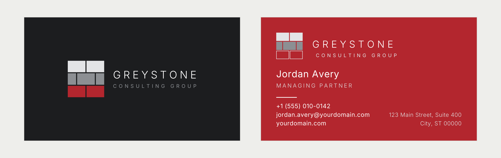

# Greystone Consulting Group — business card

- **Print files:** `greystone-business-card-vistaprint.pdf` (Vistaprint, 3.62 × 2.12 in) · `greystone-business-card-print.pdf` (⅛ in bleed, most printers)
- **Edit:** change `card-front.svg` / `card-back.svg`, then run `python3 build.py`. New text lines come from `text2path.py`.
- Full details (layout, colours, fonts, print specs) are in [`CLAUDE.md`](CLAUDE.md).
